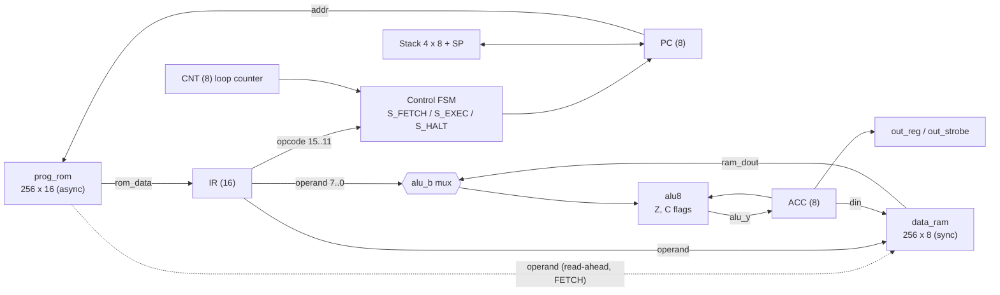
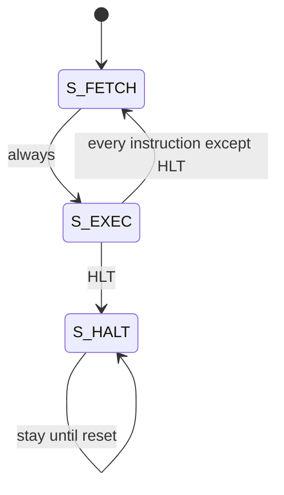
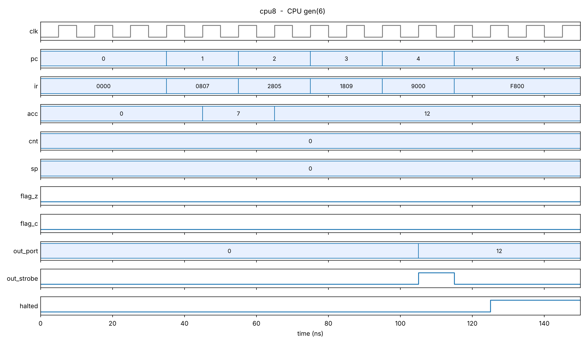
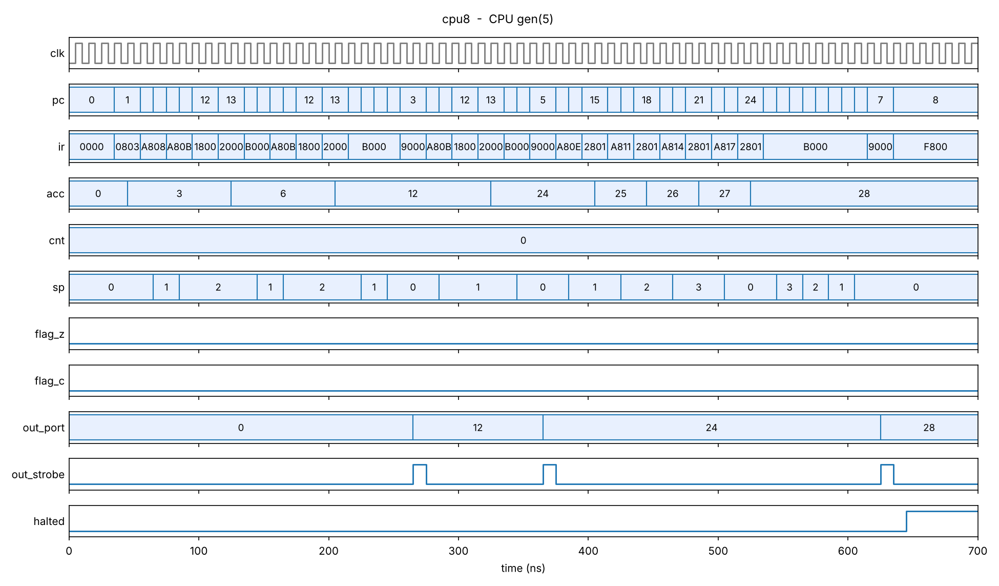

# bit-CPU-in-VHDL-from-RTL-and-Testbenches-to-FPGA-Synthesis
A compact 8-bit accumulator CPU: 16-bit instruction word, **two clock cycles per instruction**, a **hardware loop counter**, a **4-level hardware call stack**, and a strobed output port. The design is written in synthesizable VHDL-2008, verified with self-checking testbenches in **GHDL** and **Questa**, and synthesized with **Quartus Prime Lite 25.1** for a Cyclone IV E device.

| | |
|---|---|
| **Logic elements** | 239 / 114,480 (< 1 %) |
| **Fmax** | 120.34 MHz (Slow 1200 mV 85 °C model, 100 MHz constraint) |
| **Instruction set** | 24 instructions, all executing in 2 cycles |
| **Regression** | 3 self-checking testbenches, 7 CPUs and 7 programs simulated in parallel |

---

## Contents

1. [Highlights](#highlights)
2. [Architecture](#architecture)
3. [Instruction set](#instruction-set)
4. [Execution model and timing](#execution-model-and-timing)
5. [Repository layout](#repository-layout)
6. [Getting started](#getting-started)
7. [Test programs](#test-programs)
8. [Verification](#verification)
9. [Synthesis results](#synthesis-results)
10. [Writing programs and extending the CPU](#writing-programs-and-extending-the-cpu)
11. [Design notes and known limitations](#design-notes-and-known-limitations)
12. [Roadmap](#roadmap)

---

## Highlights

- **Two cycles per instruction, with a synchronous RAM.** The RAM address is taken from the instruction word while it is being fetched (*read-ahead*), so the synchronous RAM output is already valid when the execute cycle begins. This is what allows the data memory to map onto a block RAM without adding a third cycle.
- **Hardware loop counter.** `LDC n` / `LOOP addr` replace the usual load/decrement/test/branch sequence with a single instruction.
- **Subroutines.** `CALL` / `RET` use a 4-level return-address stack with a 2-bit circular stack pointer. Four nested levels are exercised by a dedicated test program.
- **Strobed output port.** `OUT` latches the accumulator into a port register and raises a one-cycle `out_strobe`, so results are observable from outside the core.
- **Verification-first workflow.** A Python golden model and mini-assembler generate the program ROM, predict every expected output, and refuse to regenerate the ROM if the model fails. The VHDL testbenches then check the RTL against the same expectations.
- **Mutation-checked testbench.** The regression was deliberately run against five intentionally broken CPUs and caught every one (see [Verification](#verification)).

---

## Architecture

### Block diagram



### Control FSM



A synchronous reset (`rst = '1'`) returns the FSM to `S_FETCH` from any state and clears all registers.

### Key parameters

| Item | Value |
|---|---|
| Data width | 8 bit |
| Architecture | Harvard (separate program ROM and data RAM) |
| Program memory | 256 × 16-bit ROM, asynchronous read, content selected by generic `PROG` |
| Data memory | 256 × 8-bit RAM, synchronous read and write, read-during-write returns the **old** value |
| Registers | `PC` (8), `IR` (16), `ACC` (8), `CNT` (8, loop counter), flags `Z` and `C`, output register |
| Call stack | 4 × 8-bit return addresses, 2-bit stack pointer (wraps around) |
| Timing | `S_FETCH` + `S_EXEC` = 2 cycles per instruction |
| Reset | synchronous, active high |

### Instruction word

```
 15      11 10     8 7              0
+----------+--------+----------------+
|  opcode  | unused |    operand     |
+----------+--------+----------------+
   5 bits    3 bits       8 bits
```

Example: `LDI 10` = `00001 000 00001010` = `0x080A`.

### Top-level interface (`cpu8`)

| Port | Dir | Description |
|---|---|---|
| `PROG` (generic) | – | Selects which test program the ROM holds (0 to 6). Default 0. |
| `clk` | in | Clock |
| `rst` | in | Synchronous reset, active high |
| `out_port[7:0]` | out | Output register, updated by `OUT` |
| `out_strobe` | out | High for exactly one clock cycle when `OUT` executes |
| `halted` | out | High once the CPU has executed `HLT` |

---

## Instruction set

All instructions occupy one 16-bit word and take **2 clock cycles**.

| Opcode | Mnemonic | Operation | Flags affected |
|---|---|---|---|
| `00000` | `NOP` | no operation | – |
| `00001` | `LDI imm` | `ACC ← imm` | Z, C ← 0 |
| `00010` | `LDA addr` | `ACC ← RAM[addr]` | Z, C ← 0 |
| `00011` | `STA addr` | `RAM[addr] ← ACC` | – |
| `00100` | `ADD addr` | `ACC ← ACC + RAM[addr]` | Z, C (carry) |
| `00101` | `ADDI imm` | `ACC ← ACC + imm` | Z, C (carry) |
| `00110` | `SUB addr` | `ACC ← ACC − RAM[addr]` | Z, C (borrow) |
| `10011` | `SUBI imm` | `ACC ← ACC − imm` | Z, C (borrow) |
| `00111` | `AND addr` | `ACC ← ACC and RAM[addr]` | Z, C ← 0 |
| `01000` | `OR addr` | `ACC ← ACC or RAM[addr]` | Z, C ← 0 |
| `01001` | `XOR addr` | `ACC ← ACC xor RAM[addr]` | Z, C ← 0 |
| `01010` | `SHL` | `ACC ← ACC << 1` | Z, C ← old bit 7 |
| `01011` | `SHR` | `ACC ← ACC >> 1` | Z, C ← old bit 0 |
| `01100` | `JMP addr` | `PC ← addr` | – |
| `01101` | `JZ addr` | `if Z = 1 then PC ← addr` | – |
| `01110` | `JNZ addr` | `if Z = 0 then PC ← addr` | – |
| `01111` | `JC addr` | `if C = 1 then PC ← addr` | – |
| `10100` | `JNC addr` | `if C = 0 then PC ← addr` | – |
| `10000` | `LDC imm` | `CNT ← imm` | – |
| `10001` | `LOOP addr` | `CNT ← CNT − 1; if CNT ≠ 0 then PC ← addr` | – |
| `10101` | `CALL addr` | push address of next instruction; `PC ← addr` | – |
| `10110` | `RET` | `PC ← popped address` | – |
| `10010` | `OUT` | `out_port ← ACC`, one-cycle strobe | – |
| `11111` | `HLT` | stop until reset | – |

### Flag semantics

- **Z** is set when the 8-bit result is zero. Because only the low 8 bits are examined, `255 + 1` sets both Z and C.
- **C** is the carry out for `ADD`/`ADDI`, the **borrow** for `SUB`/`SUBI` (set when the minuend is smaller than the subtrahend), and the bit shifted out for `SHL`/`SHR`. Logic operations and loads clear it.
- Every ALU instruction updates **both** flags, including `LDI` and `LDA`, which clear C. A consequence worth knowing: `JNC` immediately after `LDI` or `LDA` always jumps.
- `STA`, all jumps, `LDC`, `LOOP`, `CALL`, `RET`, `OUT` and `HLT` leave the flags unchanged. Programs rely on this (for example `SHR`, `STA`, `JC` in the multiplication test still sees the carry produced by `SHR`).

---

## Execution model and timing

| State | Actions |
|---|---|
| `S_FETCH` | `IR ← ROM[PC]`, `PC ← PC + 1`; the RAM is read at the address in the operand field of the instruction currently being fetched |
| `S_EXEC` | Decode `IR` and execute: update `ACC` and flags, write RAM, change `PC`, update `CNT`, push or pop the stack, drive the output port |
| `S_HALT` | Entered by `HLT`; left only by reset |

Because the RAM has a one-cycle read latency, requesting the data during `S_FETCH` makes it available at the start of `S_EXEC`. A `STA` followed immediately by an `LDA` of the same address returns the freshly written value, because the write completes at the end of `S_EXEC`, before the next fetch reads the RAM (test program `PROG4` checks exactly this).

### Cycle-accurate trace of the 5-instruction demo (`PROG6`)

Taken from the simulation waveform. Values are shown after each rising clock edge; reset is released at 30 ns.

| Cycle | Edge | State before edge | PC | IR | ACC | `out_strobe` | What happens |
|---|---|---|---|---|---|---|---|
| 1 | 35 ns | FETCH | 1 | `0807` | 0 | 0 | fetch `LDI 7` |
| 2 | 45 ns | EXEC | 1 | `0807` | **7** | 0 | ACC loaded |
| 3 | 55 ns | FETCH | 2 | `2805` | 7 | 0 | fetch `ADDI 5` |
| 4 | 65 ns | EXEC | 2 | `2805` | **12** | 0 | 7 + 5 |
| 5 | 75 ns | FETCH | 3 | `1809` | 12 | 0 | fetch `STA 9` |
| 6 | 85 ns | EXEC | 3 | `1809` | 12 | 0 | `RAM[9] ← 12` |
| 7 | 95 ns | FETCH | 4 | `9000` | 12 | 0 | fetch `OUT` |
| 8 | 105 ns | EXEC | 4 | `9000` | 12 | **1** | `out_port ← 12`, one-cycle strobe |
| 9 | 115 ns | FETCH | 5 | `F800` | 12 | 0 | fetch `HLT` |
| 10 | 125 ns | EXEC | 5 | `F800` | 12 | 0 | enter `S_HALT`, `halted = 1` |



The waveform of the nested `CALL`/`RET` program (`PROG5`) shows the stack pointer climbing 1, 2, 3, 0 (wrapping on the fourth nested call) and falling back, with the three expected outputs 12, 24 and 28:



---

## Repository layout

```
cpu8/
├── src/                  synthesizable design
│   ├── cpu_pkg.vhd         opcodes, ALU codes, instr() helper function
│   ├── alu8.vhd            combinational ALU with carry/borrow and zero flags
│   ├── data_ram.vhd        256 x 8 synchronous RAM
│   ├── prog_rom.vhd        program ROM (generated, do not edit by hand)
│   └── cpu8.vhd            CPU core: FSM, registers, stack, loop counter
├── tb/                   self-checking testbenches
│   ├── alu8_tb.vhd         22 ALU vectors
│   ├── ram_tb.vhd          RAM behaviour, including read-during-write
│   └── cpu_tb.vhd          7 CPUs / 7 programs in parallel
├── sim/                  simulation scripts
│   ├── run_ghdl.bat        GHDL regression (Windows)
│   ├── run_ghdl.sh         GHDL regression (Linux / macOS / WSL)
│   └── run_questa.do       Questa regression and waveform setup
├── synth/
│   └── cpu8.sdc            timing constraint (100 MHz clock)
├── quartus/              Quartus Prime project (cpu8.qpf, cpu8.qsf)
├── tools/
│   ├── model_and_assembler.py   golden model, mini-assembler, ROM generator
│   └── plot_waveform.py         renders a waveform PNG/PDF from a GHDL VCD file
└── docs/                 waveform images and the Quartus report summaries
```

---

## Getting started

### Requirements

| Tool | Used for | Notes |
|---|---|---|
| GHDL | simulation | Needs VHDL-2008 support (`--std=08`). Regression developed against GHDL 4.1. |
| Questa | simulation (alternative) | Run with `-2008`. |
| GTKWave | viewing `.ghw` / `.vcd` waveforms | optional |
| Quartus Prime Lite 25.1 | synthesis and timing | Cyclone IV device support must be installed. |
| Python 3 | golden model and ROM generator | standard library only |
| `matplotlib` | `plot_waveform.py` | optional: `pip install matplotlib` |

### Run the regression with GHDL

```bash
cd sim
run_ghdl.bat            # Windows (PowerShell: .\run_ghdl.bat)
bash run_ghdl.sh        # Linux / macOS / WSL
```

Expected output:

```
ALU TB: ALL 22 TESTS PASSED
RAM TB: ALL TESTS PASSED
ALL TESTS PASSED
```

A handful of `NUMERIC_STD."=": metavalue detected` warnings at `@0ms` (one per simulated CPU) are normal: some signals have no value before the first delta cycle of the simulation. The same message at any later time would indicate a real problem.

The script also writes `cpu.ghw`; open it with `gtkwave cpu.ghw`. Each simulated CPU appears as `cpu_tb/gen(N)/dut` where `N` is the program number.

### Run the regression with Questa

From the `sim` folder, either start Questa and run `do run_questa.do` in its transcript window, or:

```bash
vsim -do run_questa.do
```

The script compiles the design with `-2008`, runs the three testbenches, and then opens `cpu_tb` with the signals of the CPU running program 6 on the wave window. Change `gen(6)` in the script to inspect another program.

### Render a waveform image without a waveform viewer

```bash
cd sim
ghdl -r --std=08 cpu_tb --vcd=cpu.vcd
python ../tools/plot_waveform.py cpu.vcd --prog 6 --start 0   --end 150 --out ../docs/waveform.png
python ../tools/plot_waveform.py cpu.vcd --prog 5 --start 0   --end 700 --out ../docs/waveform_callret.png
```

The `.pdf` extension is also supported. GHDL does not write enumeration types to VCD, so the `state` signal is not drawn; view the `.ghw` file in GTKWave if you need it.

### Synthesize with Quartus

1. Open `quartus/cpu8.qpf`.
2. Confirm in *Assignments → Settings* that the device is `EP4CE115F29C7`, the top-level entity is `cpu8`, and *VHDL Input* is **VHDL 2008**.
3. Run *Processing → Start Compilation*.
4. Read *Logic elements* and *Memory bits* from the Flow Summary, and Fmax from the Timing Analyzer (*Report Fmax Summary*).

The compile produces `db/`, `incremental_db/`, `output_files/` and `simulation/` folders. They are build artefacts and are excluded by `.gitignore`.

---

## Test programs

Programs are defined in `tools/model_and_assembler.py` and compiled into `src/prog_rom.vhd`. Cycle counts come from the golden model; for `PROG6` the HDL waveform matches (10 cycles).

| Program | Purpose | Expected `OUT` sequence | Cycles |
|---|---|---|---|
| `PROG0` | Hardware loop, RAM, `ADD`: sum of 1…10 | `55` | 156 |
| `PROG1` | First ten Fibonacci numbers using RAM temporaries | `0 1 1 2 3 5 8 13 21 34` | 192 |
| `PROG2` | Shift-and-add multiply 13 × 11 (`SHR`, `JC`, `SHL`, `LOOP`) | `143` | 176 |
| `PROG3` | `AND`/`OR`/`XOR`/`SUB`, Z and C flags, `JZ`/`JNZ`/`JC` | `0x30 0xFC 0xCC 0x04 0xFE 0x02` | 56 |
| `PROG4` | `SUBI`, `JNC` taken and not taken, `STA` immediately followed by `LDA` of the same address | `7 0 255 1` | 30 |
| `PROG5` | `CALL`/`RET`, four levels of nesting | `12 24 28` | 62 |
| `PROG6` | 5-instruction demo used for the waveform trace | `12` | 10 |

---

## Verification

### Testbenches

| Testbench | What it checks |
|---|---|
| `alu8_tb` | 22 vectors covering all eight ALU operations: carry and borrow, zero flag, wrap-around, shift-out bit, and pass-through |
| `ram_tb` | Fresh RAM reads zero; write then read back; **read-during-write returns the old value**; `we = '0'` never writes; a full sweep of all 256 addresses |
| `cpu_tb` | Instantiates seven CPUs with `generate`, one per program. A monitor per CPU compares every `OUT` value against the expected list and counts outputs. The main process waits for all CPUs to halt (with a 50 µs timeout) and reports `ALL TESTS PASSED` or `SOME TESTS FAILED` |

The full regression passes in both GHDL and Questa. The CPU testbench finishes at 2045 ns of simulated time.

### Golden model

`tools/model_and_assembler.py` contains an independent instruction-level model of the CPU. It runs every program, compares the produced `OUT` values against the expected lists, and prints the instruction and cycle counts. `--gen` regenerates `src/prog_rom.vhd`, but only if every program passes in the model.

### Mutation check

A testbench that always passes is worthless, so the regression was run against five deliberately broken variants of the CPU. Every one was detected:

| Injected fault | Detected by |
|---|---|
| `JNC` condition inverted | `PROG4` produced the error-path value |
| `LOOP` terminates one iteration early | `PROG0` and `PROG1` produced wrong values / counts |
| Stack pointer incremented by 2 on `CALL` | `PROG5` produced the wrong value |
| `RET` reads the wrong stack slot | `PROG5` returned to the wrong address |
| `SUBI` takes its operand from RAM instead of the instruction | `PROG4` produced the wrong value |

---

## Synthesis results

Quartus Prime Lite Edition 25.1 (build 1129), device **EP4CE115F29C7** (Cyclone IV E), full compilation completed with **0 errors**. The synthesized design uses the default `PROG = 0`.
The raw Quartus summaries are kept in [`docs/cpu8.fit.summary`](docs/cpu8.fit.summary) and [`docs/cpu8.sta.summary`](docs/cpu8.sta.summary).


### Resources

| Resource | Used |
|---|---|
| Logic elements | **239** / 114,480 (< 1 %) |
| Memory bits | **128** / 3,981,312 |
| I/O pins | 12 (2 inputs, 10 outputs) |

Two details explain the numbers:

- **The RAM was inferred as a block memory** (`altsyncram`, single-port, 256 × 8, read-during-write mode `OLD_DATA`, matching the RTL and the testbench). Because the ROM content is constant, Quartus can prove that the four most significant RAM address bits are always zero for this program and removes them (*"Removed 4 MSB VCC or GND address nodes"*). The RAM therefore shrinks to the 16 words that `PROG0` can address: 16 × 8 = **128 bits**. The reported memory figure is a property of the synthesized program, not the architectural RAM capacity (256 × 8 = 2048 bits).
- **The 4-level call stack is implemented in logic cells**, not in a block RAM. Quartus reports it as too small to infer a RAM, which is expected for four 8-bit entries.

The ROM is a constant, asynchronous-read table and is synthesized into combinational logic, so changing the selected program changes the logic-element count.

### Timing

Constraint (`synth/cpu8.sdc`): one clock `clk`, period 10 ns (100 MHz).

| Timing model | Setup slack | Hold slack |
|---|---|---|
| Slow 1200 mV 85 °C (worst case) | +1.690 ns | +0.402 ns |
| Slow 1200 mV 0 °C | +2.467 ns | +0.354 ns |
| Fast 1200 mV 0 °C | +6.183 ns | +0.181 ns |

**Fmax = 120.34 MHz** in the worst-case (Slow 1200 mV 85 °C) model. All constraints are met. Because the 100 MHz target was already satisfied, the fitter ran in Auto Fit mode and did not optimize for speed, so this is a conservative figure rather than a ceiling.

Only the clock is constrained; input and output delays are not, so Quartus reports the design as not fully constrained. The 12 pins have no board pin assignments because the design has only been synthesized, not placed on a specific board.

---

## Writing programs and extending the CPU

### Assembling a program

Programs are Python lists of `(label, mnemonic, operand, comment)` tuples. Operands can be numbers or labels:

```python
P6 = [  # the 5-instruction demo
 (None, "LDI",  7,    "ACC = 7"),
 (None, "ADDI", 5,    "ACC = 12"),
 (None, "STA",  9,    "RAM[9] = 12"),
 (None, "OUT",  None, "output 12"),
 (None, "HLT",  None, "stop")]
```

To add a program: define the list, append it to `PROGS`, add its expected outputs to `EXPECT`, run `python model_and_assembler.py --gen` inside `tools/`, then add the program to `N_PROG`, `EXP_COUNT` and `EXP` in `tb/cpu_tb.vhd`.

### Adding an instruction

1. Add an opcode constant to `src/cpu_pkg.vhd` (and, if it needs a new ALU function, an ALU code).
2. Add a branch to the `S_EXEC` `case` in `src/cpu8.vhd`; update the `alu_op` selection and the immediate-operand mux if it uses the ALU.
3. Add the mnemonic to the golden model's opcode table and execution function in `tools/model_and_assembler.py`.
4. Write a test program that exercises it, regenerate the ROM, and extend `cpu_tb.vhd`.

---

## Design notes and known limitations

- **Loop counter wrap-around.** `LDC 0` followed by `LOOP` runs the loop 256 times because the counter wraps.
- **Stack behaviour.** The stack is circular with four entries. A fifth nested `CALL` overwrites the oldest return address, and `RET` with an empty stack jumps to whatever the slot holds (address 0 after reset). There is no overflow or underflow detection.
- **Undefined opcodes** behave like `NOP`.
- **Unsigned arithmetic only.** The CPU has Z and C flags but no negative or overflow flag.
- **Fixed memory sizes.** 256 program words, 256 data bytes, 8-bit program counter.
- **No multiply, divide or interrupts.** Multiplication is done in software (`PROG2`).
- **Verified in simulation and synthesis only.** The design has not been run on physical hardware.
- **Startup warnings.** The `metavalue` messages at 0 ns described above are harmless.

---

## Roadmap

- Hardware multiply: a dedicated `S_MUL` FSM state performing eight shift-and-add steps
- Output to a seven-segment display or a UART
- Negative and overflow flags with signed branch instructions
- Interrupt input
- Board bring-up with pin assignments and a clock divider
